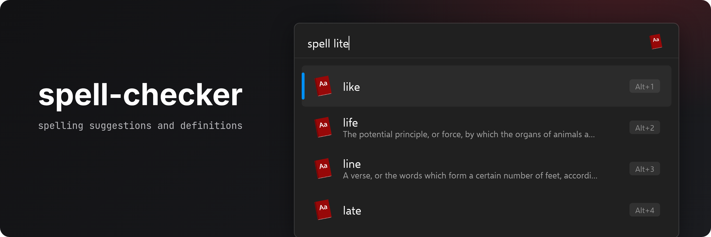

<!-- generated by readwright from docs/README.md.j2; edit the template, not this file -->


# Spell Checker

Spelling suggestions and word definitions in Flow Launcher.

[](https://github.com/Garulf/spell-checker/actions/workflows/tests.yml) [](https://github.com/Garulf/spell-checker/releases/latest)

[](https://www.buymeacoffee.com/garulf) [](https://github.com/sponsors/Garulf)

## Features

* **Suggestions as you type.** Every likely correction for a misspelled word, best match first.
* **Definitions.** Each suggestion shows its dictionary definition when there is one.
* **Whole sentences.** Type more than one word to correct the whole line at once.
* **Clipboard aware.** Open the plugin with a single word copied and it offers to check it.
* **Fully local.** Powered by [TextBlob](https://github.com/sloria/TextBlob). No web requests, no API keys.

## Usage

Type `spell` followed by a word, then press `Enter` to copy the suggestion you want:

```
spell lite
```


| Query | Result |
| --- | --- |
| `spell <word>` | Suggested spellings, most likely first, with definitions |
| `spell <sentence>` | The whole sentence with every word corrected |
| `spell` | Offers the word on your clipboard, if there is exactly one |

### Correct a sentence

Type more than one word and select the result to copy the corrected sentence:


### Check the word on your clipboard

Copy a single word, type `spell` and press `Enter` to check it:


## Installation

### Flow Launcher

In Flow Launcher, type:

```
pm install spell checker
```


### Manual installation

Download `spell-checker-<version>.zip` from the [latest release](https://github.com/Garulf/spell-checker/releases/latest) and unzip it into
`%appdata%\FlowLauncher\Plugins`, then restart Flow Launcher.

Pre-releases of the next version are published from the open release PR on the
[releases page](https://github.com/Garulf/spell-checker/releases) for testing. Flow Launcher won't offer them as updates.

## Requirements

* Flow Launcher 1.17.0 or newer
* Python 3.8 or newer, which Flow Launcher can install for you

## Changelog

### [0.1.0](https://github.com/Garulf/spell-checker/releases/tag/v0.1.0) - 2022-09-18

- Update Flox to 0.18.1 in https://github.com/Garulf/spell-checker/pull/1

### [0.0.5](https://github.com/Garulf/spell-checker/releases/tag/v0.0.5) - 2022-01-23

- Fix encoding issues with the dictionary file.

### [0.0.4](https://github.com/Garulf/spell-checker/releases/tag/v0.0.4) - 2022-01-20

- Insert a single word from the clipboard into the query.

See [CHANGELOG.md](CHANGELOG.md) for the full history.
